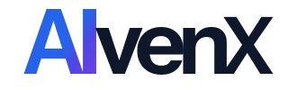
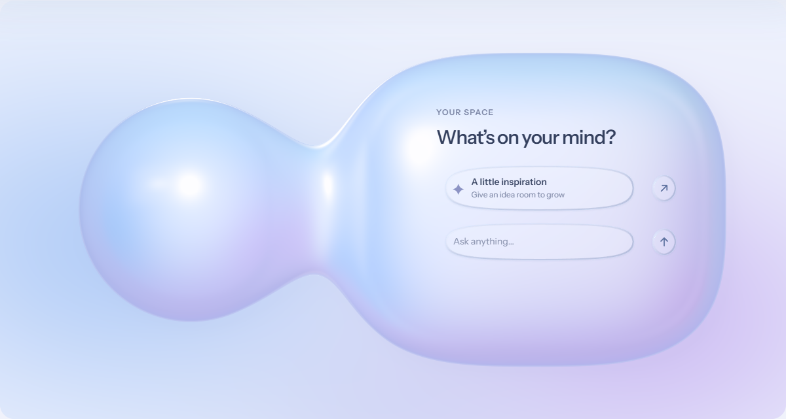

<p align="center"></p>

# AlvenX Liquid Glass

Full pearl volumes, refractive controls, and continuous motion. An independent React 19 design kit with a live material playground, a precise design specification, and measured rendering evidence.

**[Explore the live showcase](https://alvenx.com/ui/)** · [Design language](docs/design-language.md) · [Integration guide](docs/integration.md) · [Performance comparison](https://alvenx.com/ui/docs/hover-comparison.html)

[](https://alvenx.com/ui/)

Version **1.1.2** is a public design preview. It preserves the owner-approved v6 material and the 1.1.1 optimized rendering kernels; this release prepares the public showcase, notices, documentation and reproducible checks. Authoring specifications are in Chinese; component labels and the showcase are in English.

## Try it locally

Use Node.js **22.13+** (or Node 20.19+ supported by the kit), npm, and React 19:

```sh
npm ci
npm run dev
```

Open `http://127.0.0.1:5174/`. Drag the sliders beyond their endpoints, re-grab during the return, move the lens across text, and edit the material values directly. Reset restores the material defaults, including **glass background opacity 0.3**. Both blur ranges remain **0–6 px**.

## What is included

- `LiquidControl`: contour-matched button, field, lens and circular control surfaces.
- `GlassSlider`, `GlassSwitch`, `GlassNumber`: continuous gestures, bounded overdrag, release-only spring return and validated numeric drafts.
- `VolumeStage`: mother form, soft connection and expanding content chamber, with slow budding and a canvas pixel budget.
- `GlassClock` and `useGlassSettings`: shared activity scheduling, visibility handling, settings persistence and reduced motion.
- Scoped CSS, blue/indigo/violet tokens, canonical AlvenX assets, Instrument Sans and MiSans with their individual licenses.

Large forms use an analytic 2.5D environment approximation. Small glass controls refract the actual browser backdrop where supported. Text remains selectable native DOM content outside the optical filter.

## Use in another React project

Build and create a local package; the versioned tarball can be installed directly. The package is **not published to the npm registry**.

```sh
npm run build
npm run pack:kit
# In your React 19 project:
npm install ./alvenx-liquid-glass-1.1.2.tgz
```

```tsx
import {
  GlassSlider,
  LiquidControl,
  useGlassSettings,
} from '@alvenx/liquid-glass';
import '@alvenx/liquid-glass/styles.css';
import '@alvenx/liquid-glass/fonts.css';

export function GlassExample() {
  const { clock, settings, updateSettings, reset } = useGlassSettings({
    storageKey: 'example-project:glass:v1',
  });

  return (
    <section className="alvenx-design">
      <GlassSlider
        id="interactionStrength"
        label="Interaction strength"
        min={0}
        max={4}
        step={0.1}
        unit="×"
        value={settings.interactionStrength}
        clock={clock}
        onChange={(value) => updateSettings({ interactionStrength: value })}
      />
      <LiquidControl id="example-reset" className="example-reset" clock={clock} onClick={reset}>
        Reset defaults
      </LiquidControl>
    </section>
  );
}
```

The host owns layout, control dimensions and actions:

```css
.alvenx-design .example-reset { width: 148px; height: 44px; }
```

For SSR, custom backgrounds, alternate rendering and lifecycle guidance, read the [integration guide](docs/integration.md). Public visibility does not itself grant a reuse license; see the license section below.

## Verification and measured limits

```sh
npm run check
npm run build
npm run test:contract
npm run test:runtime
node scripts/verify-kit.mjs --baseline-only
npm run pack:kit
npm run test:install
```

The original v6 acceptance manifest is preserved with its 41 files. Contract tests compare current geometry and endpoints against that frozen source. Runtime checks cover clock cadence, pixel budgets and exact normal-map output; a fresh consumer install checks package exports and the README example.

The measured 1.1.0 → 1.1.1 sustained-hover case reduced median scripting occupancy **32.75% → 25.47%**, and total main-thread occupancy **57.64% → 54.96%**. Three settled-state image comparisons were pixel-identical. This is one documented desktop scenario, not a universal performance guarantee. See the [self-contained comparison](docs/hover-comparison.html) for the method, samples and visual evidence.

Automatic rendering selects SVG backdrop refraction in validated Chromium environments and compatible native/flat appearances elsewhere. Windows Chromium, Firefox and Playwright WebKit have functional evidence; physical Safari/iOS, touch, OS IME, assistive technology and sustained mobile power use remain validation work. Alternate appearances preserve geometry and controls, with different optical fidelity. See [compatibility](docs/compatibility.md) and [runtime quality](docs/runtime-quality.md).

Raw machine-specific audit files stay local in ignored `docs/validation/`; the public comparison embeds its relevant screenshots and measurements. Source checks regenerate their own reports. Historical validation is identified by version rather than presented as a test of later changes.

With Playwright CLI available, run the real showcase header, narrow-layout and navigation checks against an open local or public showcase:

```sh
playwright-cli -s=glass-qa open http://127.0.0.1:5174/
playwright-cli -s=glass-qa run-code --filename=scripts/showcase-browser-qa.cjs
playwright-cli -s=glass-qa close
```

## Documentation and source map

| Path | Purpose |
| --- | --- |
| [Design language](docs/design-language.md) | Contour, edge light, typography, B endpoints and numeric input contracts |
| [Integration](docs/integration.md) | React API, host responsibilities and adaptation points |
| [Runtime quality](docs/runtime-quality.md) | Scheduling, buffers, cache, pixel budgets and measured costs |
| [Compatibility](docs/compatibility.md) | Rendering probes, automatic selection and validation boundaries |
| [Baseline and checklist](docs/baseline-and-checklist.md) | Acceptance identity and versioned checks |
| [Attribution](docs/attribution.md) | References and individual asset notices |
| `src/`, `styles/`, `tokens.json` | Library implementation and scoped styles |
| `showcase/` | Editable public playground; build emits `site-dist/` |
| [SKILL.md](SKILL.md) | Project-local instructions for subsequent design work |

## License and attribution

Copyright © 2026 AlvenX. Source and design are publicly viewable with **all rights reserved** while the owner selects a reuse license; `license: UNLICENSED` and `private: true` prevent accidental npm publication. This is not an MIT-licensed project. Brand assets and fonts retain their separate terms. Instrument Sans uses SIL OFL 1.1; MiSans uses its own bundled agreement. Preserve all notices. See [LICENSE-NOTICE.md](LICENSE-NOTICE.md).

The optical studies by [Kube](https://kube.io/blog/liquid-glass-css-svg/) and [Apple's Liquid Glass design session](https://developer.apple.com/videos/play/wwdc2025/219/) informed the research. This is AlvenX's implementation and design language; it does not use Apple's native renderer.
