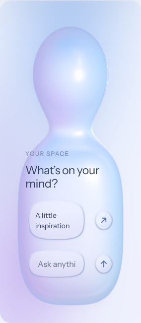

# R1 — rejected vertical composition / 已否决的竖向构图

**Status: rejected. Review date: 2026-10-19.** This is a historical review record, not the current design specification or an accepted release.

此小样基于 **1.1.2**，曾发布于[独立 R1 审查页](https://alvenx.com/ui/review-20261019/)；[原环境动效对照](https://alvenx.com/ui/review-20261019/?studio=off)保留为原入口记录。网址以后可能变化，不能用以后打开的页面替代本目录截图与 Git 历史。运行时代码与此审查记录由不可变标签 [`review-20261019-r1-rejected`](https://github.com/AlbertXXuu/alvenx-liquid-glass/tree/review-20261019-r1-rejected) 对应；`summary.json` 记录相同来源标识。

## Owner decision / 用户决定

用户原话：

> 我不是让你把横着的变成竖的！！！你理解错误我意思了，你这样竖着也不好看，文本排版有有很大问题。你之后把你生成的东西自己截屏检查一下看看，现在做的太烂了，做到足够好的时候再上传到网站上让我审查。

否决范围是把横向形体直接转成竖向的构图，以及对应的文字排版。**不再把这套竖向方案当作下一版默认方向。** 输入修复并未因此被否决，但仍不等于用户已通过真机验收；新修订也不能继承一次技术检查就标记为 accepted。

## Retained engineering work / 可保留的工程修复

- 活动指针约束、取消清理，以及滑条／开关上的纵向浏览手势。
- 连续拖动、端点余量、越界回弹、重新抓取与开关中点切换。
- 键盘编辑与即时焦点变化的队列处理。
- 参数存储合并、离页保存；透镜拖动与正文文本选择的区分。
- 隐藏自定义玻璃轮廓下面的原生 range 平台绘制。

这些项目仅保留各自已有测试证据，等待后续回归和用户真机确认，不是对全部操作或所有设备的保证。

## Captured appearance / 当时的界面

下图来自 Windows 上的 Playwright WebKit 26.5 模拟视窗；没有复制用户的手机或 iPad 实机附件。截图是已存在证据的原样副本，不是重新生成或事后美化。

| Viewport / 视窗 | Stage / 形体 | Controls / 控件 |
| --- | --- | --- |
| Phone 320 × 740 | [查看](webkit-320-review-stage.png) | — |
| Phone 393 × 852 | [查看](webkit-393-review-stage.png) | [查看](webkit-393-review-controls.png) |
| Tablet portrait 768 × 1024 | [查看](webkit-768-review-stage.png) | — |
| Tablet landscape 1180 × 820 | [查看](webkit-1180-review-stage.png) | [查看](webkit-1180-review-controls.png) |

320px 小样中的母体被拉成纵向，标题换成两行，卡片空间与输入可见宽度不足；768px 小样仍沿用同一竖向构图。几何边界检查虽然记录为没有舞台溢出、前景位于舞台内，但这不足以证明文字排版合适或视觉方案成立。用户的否决覆盖这些审美与布局问题。

## Verification and remaining limits / 验证与剩余问题

[机器可读摘要](summary.json)只保留浏览器测试名称、结果、布局尺寸和构建检查统计；[SHA-256 清单](SHA256SUMS.txt)用于核对六张截图。本目录没有密钥、认证日志、部署原始日志、绝对用户目录或实机附件。

当时的 Chrome、Edge 与 Windows WebKit 自动化回归通过，不代表实体 Safari、触控板、软键盘、旋转或分屏已验收。用户反馈的首次点击卡顿没有被稳定复现，也没有被认证修好。Safari 小控件仍使用兼容材质；R1 没有实现可控背景的真实折射，更不能宣称任意 DOM 的折射已兼容。

2026-10-16 已确认的 v6 原件及其 manifest 保持不变：`8eb6bf9395ec63b2020211bb8b21815060d7399e27f9dbdd1f2128275760cb8d`。R1 的失败不会改写该基线。
