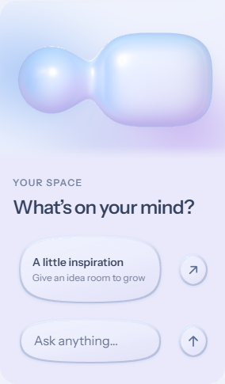

# R2 — horizontal composition / 横向构图修订

**Status: self-reviewed. Recorded: 2026-10-19.** 本地技术检查、引擎回归、构建、截图自检及实际 tarball 的外部消费项目验证已通过；最终重打包哈希核对、源码标签推送及网页发布仍待登记。**未获用户真机验收，不标记 accepted。**

## Requirement and candidate / 要求与当前候选

用户明确要求各宽度保留横向关系，并要求先自行截图检查，再发布独立网址审查。原话：

> 我不是让你把横着的变成竖的！！！你理解错误我意思了，你这样竖着也不好看，文本排版有有很大问题。你之后把你生成的东西自己截屏检查一下看看，现在做的太烂了，做到足够好的时候再上传到网站上让我审查。

当前 Decision B 使用原始 **1000 × 560 横向逻辑场景和等比相机**；没有把形体旋成竖向，也没有另外压缩母体或拉长内容腔。按实际容器宽度安排正文：

| Container width / 容器宽度 | Candidate / 本版候选 |
| --- | --- |
| 小于 600 CSS px | 原横向完整形体作为上方概览；正常宽度的正文和控件在下方。此手机呈现仍待用户确认。 |
| 600–899 CSS px | 横向完整形体，正文整合在内容腔内。 |
| 至少 900 CSS px | 宽屏横向整合布局。 |

断点基于容器，不能把 640px 视窗误读为 640px 舞台。全程只有一份持久前景 DOM；跨布局切换保持同一输入节点、文字草稿和焦点，避免为不同宽度复制不同表单。

## Source and review route / 来源与审查入口

| Item | Current record |
| --- | --- |
| Package base | 1.1.2，独立审查修订，并非新的正式验收版本 |
| Working source | [codex/compact-horizontal-review](https://github.com/AlbertXXuu/alvenx-liquid-glass/tree/codex/compact-horizontal-review)，内容会继续变化 |
| Previous snapshot | [review-20261019-r1-rejected](https://github.com/AlbertXXuu/alvenx-liquid-glass/tree/review-20261019-r1-rejected)，`80eb02e` |
| Planned R2 snapshot | [review-20261019-r2](https://github.com/AlbertXXuu/alvenx-liquid-glass/tree/review-20261019-r2)，尚未在本记录确认建立／推送 |
| Planned new review URL | [独立 R2 审查入口](https://alvenx.com/ui/review-20261019-r2/)，尚未在本记录确认发布 |
| Historical R1 URL | [原 R1 审查入口](https://alvenx.com/ui/review-20261019/)，不是本版 R2 的验收入口 |

新旧审查路径分开记录；网址以后变化也不覆盖已保存的截图、哈希与源标签。代码继续公开并保留版权，不因此授予开源复用许可。

## Screenshot self-review / 发布前截图自检

在本版网站发布前，根代理和独立视觉审查代理检查了本地候选，未发现阻止此次提交用户体验的排版问题。这是代理判断，不是用户接受手机布局或材质。

Chromium 155.0.8059.84 的九组视窗为 **320、360、393、430、640、768、820、1024、1366px**；保存了正常状态，以及 320／393／768／1366px 的按压、聚焦、中英混合消息状态，并检查了 320／768／1366px 的参数与组件区。本目录保留有代表性的 30 张 Chromium、Windows WebKit 和 Edge 原始截图；全量本地证据名称由摘要注明。

| Appearance / 外观 | Selected evidence / 选定证据 |
| --- | --- |
| 正常状态，手机 | [320px](evidence/chromium-320-normal.png) · [360px](evidence/chromium-360-normal.png) · [393px](evidence/chromium-393-normal.png) · [430px](evidence/chromium-430-normal.png) |
| 正常状态，平板／桌面 | [640px](evidence/chromium-640-normal.png) · [768px](evidence/chromium-768-normal.png) · [820px](evidence/chromium-820-normal.png) · [1024px](evidence/chromium-1024-normal.png) · [1366px](evidence/chromium-1366-normal.png) |
| 按压与聚焦 | [320px pressed](evidence/chromium-320-pressed.png) · [768px pressed](evidence/chromium-768-pressed.png) · [393px focus](evidence/chromium-393-focus.png) · [1366px focus](evidence/chromium-1366-focus.png) |
| 中英消息 | [320px](evidence/chromium-320-message.png) · [768px](evidence/chromium-768-message.png) · [1366px](evidence/chromium-1366-message.png) |
| 参数与组件区 | [320px parameters](evidence/chromium-320-parameters.png) · [768px parameters](evidence/chromium-768-parameters.png) · [320px components](evidence/chromium-320-components.png) · [1366px components](evidence/chromium-1366-components.png) |

## Recorded technical checks / 已记录技术检查

[视觉与尺寸摘要](evidence/visual-checks.json)记录九宽度的实际结果：没有页面／舞台横向溢出或画布错误，输入字体为 16px，空白提示的实测宽度小于输入可见宽度。矩形边界检查不能独立代替实际轮廓、文字间距和外观审查，所以另外保留了上面的截图自检。

[形体和持久 DOM 摘要](evidence/volume-checks.json)记录：

- 在 1000 × 560、time 0、studio motion 关闭的四组场景中，与冻结 v6 的实际 GPU 比较得到 **最大通道差 0**。这是四组指定状态的证据，不是所有参数、所有时间或所有引擎的通用保证。
- Chromium／Windows WebKit 在 1440→820→768→600→393→320→1440px 切换时保持同一原生输入节点，保留数值草稿 `0.` 和中英消息，没有横向裁切。
- Chromium 原生触摸注入覆盖 393×852、768×1024、1180×820：横向拖动形体持续持有且舞台不横移，纵向滑动可滚页。
- WebKit 出芽生命周期：修复了 Replay 后滚出屏幕导致生长进度停在早期、前景持续隐藏的问题；离屏期间不增加 WebGL 绘制，布局切换到概览时正文可见。

这些检查不等于实体 iPhone、iPad、Safari 或 Combo Touch 验收，也不证明稳定 FPS。首次点击卡顿、Safari 小控件真实折射和设备性能仍需分别确认；现有兼容材质不能冒充任意 DOM 的真实背景位移。

## Cross-engine and build / 跨引擎与构建

[Windows WebKit 26.5](evidence/visual-webkit-checks.json) 同样通过九宽度检查，页面错误为 0；选定外观见 [320px normal](evidence/webkit-320-normal.png)、[768px normal](evidence/webkit-768-normal.png)、[768px focus](evidence/webkit-768-focus.png)、[1366px bilingual message](evidence/webkit-1366-message.png)。它不是实体 Safari 测试。

[控件回归](evidence/control-checks.json)记录 Chromium 的 30 项检查：鼠标／键盘、滑条和开关端点回弹重抓、数值归正、纵向滚页而不误改控件、第二指不抢占、参数保存合并。拖动过程中同步存储写入为 0，静置后为 1；这不是 CPU 或真机性能基准。

[Edge 与构建摘要](evidence/engine-build-checks.json)记录 Windows Edge 155.0.4283.62 默认 UA 的 10 项回归通过、错误为 0，SVG 模式 ready 为 true；[正常外观](evidence/edge-1366-normal.png)和[聚焦外观](evidence/edge-1366-focus.png)由验证代理查看。Kit 的 check、build、28 项 contract／15 组 geometry、16 项时钟、180 组像素预算、5800 组 Float32 光学核检查已通过。[打包安装回执](evidence/install-receipt.json)记录实际 tarball 在仓库外全新消费项目中完成 npm install、类型检查和生产构建，三个退出码均为 0。受测 tarball SHA-256 为 `9898afaef74c4bca4e314ebdbd9526bb843d5a9eb2f682506e510185127e47cd`；本回执不包含另一次安装产物浏览器或实机验收。

## Whole-page production preview / 本地产物的整页检查

[本地生产构建验证](evidence/production-build-checks.json)重新执行了 23 项控件回归，全部通过；393／768／1366px 的页面区块检查通过、页面错误为 0。根代理另外查看了入口、手机导航、设计说明和中英文排版截图，未发现本轮提交审查的阻断问题。保留 [393px intro](evidence/page-393-intro.png)、[393px menu](evidence/page-393-menu.png)、[393px design](evidence/page-393-design.png)、[768px design](evidence/page-768-design.png)，避免只检查形体舞台而漏掉整页正文。

这里的 production build 指本地构建产物预览，不代表已向正式网站部署，也不代替用户真机审查。

## Iterations and status / 中间版本与状态

- [Iteration 01 — self-rejected](iterations/01-self-rejected/README.md)：紧凑比例与 C2 边缘文字留白未达标，改写前已保存源码补丁和截图；不是用户再次否决。
- [Iteration 02 — intermediate](iterations/02-intermediate/README.md)：保存中间效果；初次控件空白与截图的可见性唤醒时序有关，不能据此判为代码失败。
- [Iteration 03 — intermediate](iterations/03-intermediate/README.md)：保留下一次中间效果，没有补写验收结论。02／03 没有当时的精确源码快照，不提出完全复现声明。

[主摘要](summary.json)跟踪局部证据与发布状态，[SHA-256 清单](evidence/SHA256SUMS.txt)覆盖选定截图和脱敏检查摘要。原始认证／部署日志、绝对用户目录和用户实机附件没有复制到这里。R1 历史和已确认 v6 原件不变。

根代理完成最终重打包哈希核对、源码标签推送和实际网址发布后更新记录，再将状态改为 `published-awaiting-owner`。用户只有在可访问的独立网址上体验手机、iPad 和 Combo Touch 后，才能明确确认或否决该版本；在此之前保持非 accepted 状态。
