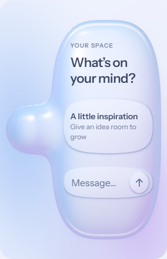

# R2 local iteration 01 — self-rejected / 本地自检否决

**Iteration status: `self-rejected`. Parent R2 status: `draft`. Date: 2026-10-19.** 这是代理截图自检后否决的本地迭代，不是用户又否决了一版，也没有作为新方案上传网站。

本轮已保持横向轴，但紧凑构图仍不合格：手机上的右内容腔过高，母体退化为小徽标；768px 视窗中的文字接近／触及真实 C2 轮廓边缘。矩形边界内、页面无溢出和无脚本错误不能证明真实曲面中的文本留白成立。1366px 的比例可作为下一次局部调整的参考；这仅是自检判断，不是用户确认。

## Preserved before rewrite / 改写前保存

- [源码补丁](source-from-r1.patch)由 Git 直接按二进制补丁格式写入，记录从 R1 标签 `review-20261019-r1-rejected`（`80eb02e`）到此本地迭代的 `src/`、`styles/`、`showcase/` 改动。下一次几何改写开始前已保存。
- 五张已有截图原样复制，没有重新生成、裁切或美化；来源为本地 `horizontal-review-2026-10-19` 证据集。
- [机器可读摘要](summary.json)只保留已观察尺寸、错误计数和自检结论；[SHA-256 清单](SHA256SUMS.txt)覆盖补丁与五张图。

| Viewport | Stage screenshot |
| --- | --- |
| 320 × 852 | [320px stage](iteration01-320-stage.png)；[experience context](iteration01-320-experience.png) |
| 393 × 852 | [393px stage](iteration01-393-stage.png) |
| 768 × 1024 | [768px stage](iteration01-768-stage.png) |
| 1366 × 1024 | [1366px stage](iteration01-1366-stage.png) |

截图由 Windows Chromium 155.0.8059.84 的触控／iPad UA 模拟视窗生成，DPR1；并非 iPhone、iPad 或实体 Safari 截图。物理设备首次点击卡顿、Combo Touch 和 Safari 折射问题仍不能由此认证已解决。

下一轮在本地修正紧凑几何和文字安全边界后，重新截图自检；达到相应检查要求后才发布独立网址给用户审查。父 R2 仍为 draft，不标记 self-reviewed、published 或 accepted；R1 归档与 v6 原件保持不变。
